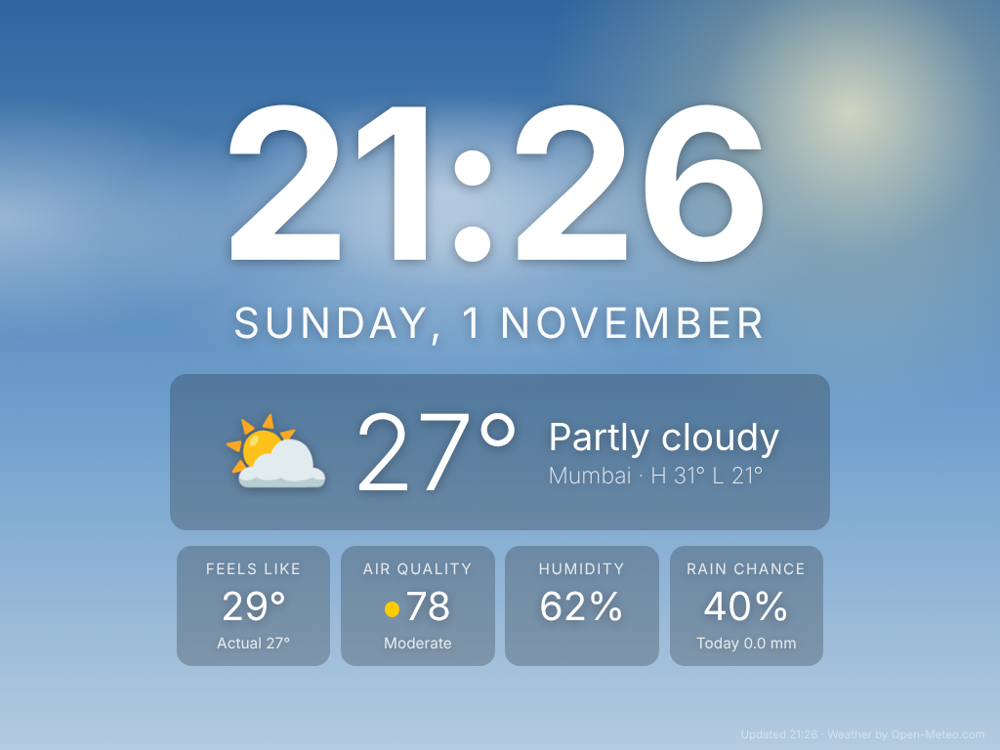
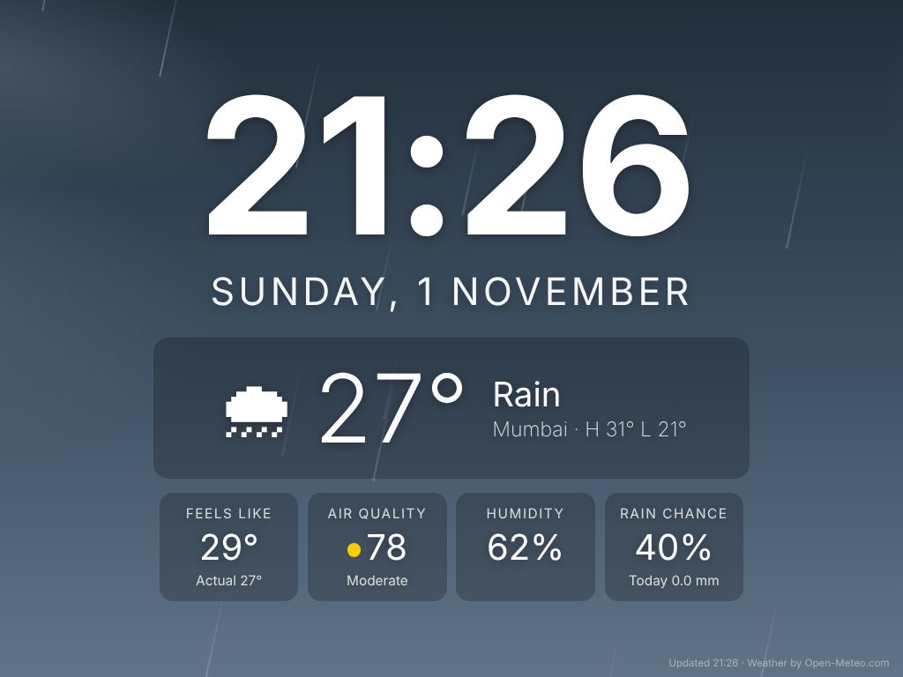
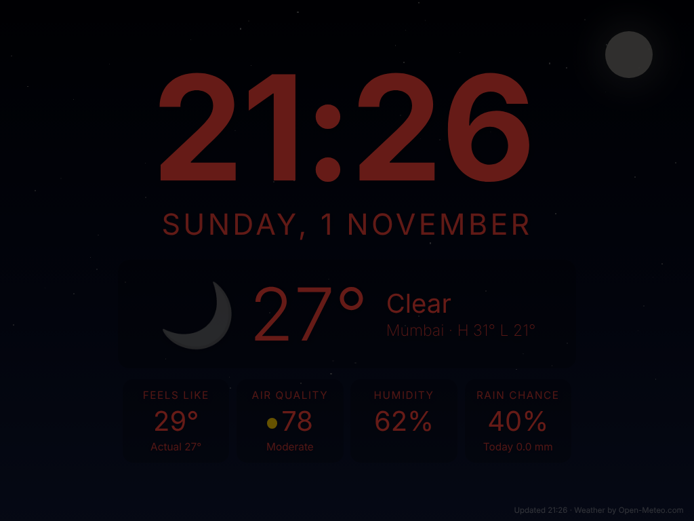
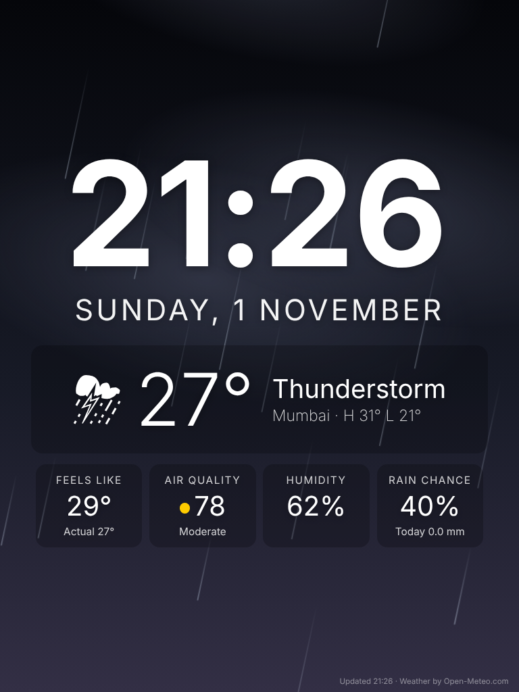

# 🕰️ Night Clock — a bedside clock + weather display for old iPads

Turn an old iPad (or any tablet) into a beautiful full-screen bedside clock with live weather.
Built and tested for an **iPad mini (1st gen) on iOS 9.3.5**, where almost every App Store clock app no longer installs.

**No app install. No account. No API key. One HTML file.**

👉 **Try it now:** [live demo (cycles through all weather backgrounds)](https://tanmayk301.github.io/Clock/nightclock.html?lat=19.07&lon=72.88&name=Mumbai&demo=1)

| Day | Rain |
|---|---|
|  |  |
| **Night mode (auto, 10 PM – 6 AM)** | **Portrait** |
|  |  |

---

## ✨ Features

- **Big bold clock** with day and date, readable from across the room
- **Live weather**: temperature, conditions, today's high/low
- **Feels like, Air Quality (AQI, colour coded), Humidity, Rain chance**
- **Background that follows the weather**: sunny sky with sun glow, starry night with moon, drifting clouds, falling rain, thunderstorm with lightning, fog, snow, plus an orange sky around sunrise and sunset
- **Automatic night mode**: dims the screen and switches to red text so it won't light up the bedroom
- **Tap anywhere** to cycle brightness (4 levels)
- Works in **landscape and portrait**
- Refreshes weather every 15 minutes and reloads itself daily at 4 AM, so it can run 24/7
- Written in plain old JavaScript (ES5) so it runs on **Safari for iOS 9**, and on any modern browser too

> A jailbreak is **not** needed. It's just a web page you pin to the home screen.

---

## 🚀 Use it in 2 minutes (no hosting needed)

You can use the hosted version directly. Just add your own location to the link.

1. **Find your coordinates:** open Google Maps, long-press your location, and copy the two numbers shown (e.g. `28.6139, 77.2090`).
2. **Build your link.** The first number is `lat` and the second is `lon`:
   ```
   https://tanmayk301.github.io/Clock/nightclock.html?lat=28.61&lon=77.21&name=Delhi
   ```
3. Open the link in **Safari** on the iPad.
4. Tap **Share → Add to Home Screen**. Always launch it from that icon; it opens full-screen.
5. Go to **Settings → Display & Brightness → Auto-Lock → Never** and keep the iPad plugged in.

**Optional:** turn on *Settings → General → Accessibility → Guided Access*, open the clock and triple-click the Home button. This locks the iPad to the clock so a tap can't exit it.

If you don't add coordinates, the clock asks for your location instead.

---

## ⚙️ Link options

Add any of these to the end of the link, separated by `&`:

| Option | What it does |
|---|---|
| `lat=..&lon=..` | Your location (required for weather) |
| `name=Delhi` | Place name shown on screen |
| `h12=1` | 12-hour clock with AM/PM |
| `fx=0` | Turn off background animations (for very slow devices) |
| `red=0` | Keep white text in night mode |
| `night=1` / `night=0` | Force night mode on / off |
| `scene=rain-day` | Force a background: `clear-day`, `clear-night`, `partly-day`, `partly-night`, `cloudy-day`, `cloudy-night`, `golden`, `rain-day`, `rain-night`, `storm`, `fog-day`, `fog-night`, `snow-day`, `snow-night` |
| `demo=1` | Cycle through all backgrounds every 7 s |

Example: `...nightclock.html?lat=19.07&lon=72.88&name=Mumbai&h12=1`

To change the night-mode hours (default 22:00–06:00), edit `NIGHT_START` / `NIGHT_END` at the top of the script.

---

## 🏠 Host your own copy (optional)

1. Fork this repo (or create a new public repo and upload `nightclock.html`).
2. Go to **Settings → Pages → Deploy from a branch → main / root → Save**.
3. After about a minute your copy is live at `https://YOUR-USERNAME.github.io/REPO-NAME/nightclock.html`.

You can also simply open `nightclock.html` in any browser.

---

## 🛠️ Troubleshooting

| Problem | Fix |
|---|---|
| Page shows a certificate / security warning | Make sure the iPad's date and time are correct (*Settings → General → Date & Time → Set Automatically*). |
| Clock works but weather says "unavailable" | Check Wi-Fi. Very old iOS versions may reject newer security certificates; the app retries automatically every 15 minutes. |
| Still seeing an old version after an update | Delete the home-screen icon and add it again from Safari. |
| iPad feels slow or warm | Add `&fx=0` to the link to turn off animations. |

---

## 📱 Compatibility

- ✅ iPad mini 1, iOS 9.3.5 (primary target)
- ✅ Should work on iOS 9+ iPads and iPhones, Android tablets, and desktop browsers
- Needs Wi-Fi for weather; the clock itself works offline once loaded

---

## 🙏 Credits

- Weather and air quality data: [Open-Meteo.com](https://open-meteo.com/) (free, no API key, [CC BY 4.0](https://creativecommons.org/licenses/by/4.0/))
- Made by [@tanmayk301](https://github.com/tanmayk301) to give an old iPad a second life

## 📄 License

MIT. Free to use, modify and share. See [LICENSE](LICENSE).

If this brought your old iPad back to life, a ⭐ on the repo is appreciated!
